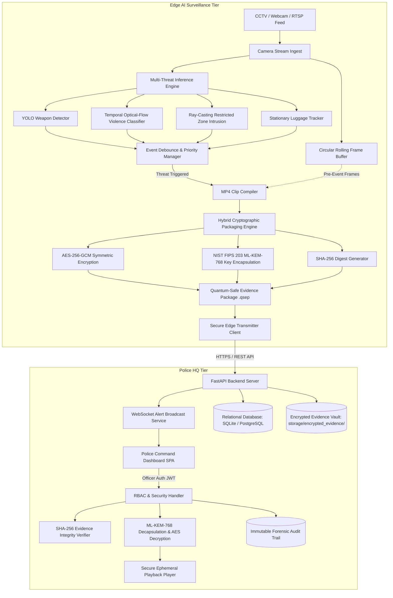
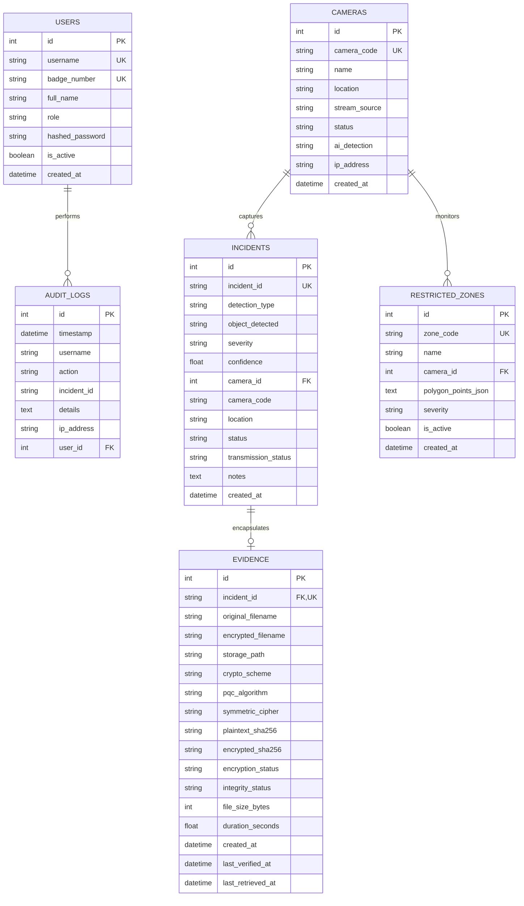

# System Architecture & Technical Specifications

**Project Title:** Edge AI-Based Crime Detection and Quantum-Safe Digital Evidence Management Framework

---

## 1. High-Level Architecture

The system operates across two primary tiers:
1. **Edge AI Surveillance Tier**: Deployed on edge nodes / CCTV processing units. Responsible for real-time video stream ingestion, multi-model AI inference, threat classification, debounce control, circular video buffering, and hybrid post-quantum encryption.
2. **Police Command HQ & Evidence Vault Tier**: Centralized backend server and web command center. Responsible for real-time alert broadcasting via WebSockets, post-quantum key generation, relational database management, evidence storage, cryptographic integrity verification, and authorized decryption.



---

## 2. Hybrid Post-Quantum Cryptographic Specification

To protect digital surveillance evidence against future quantum computer attacks (running Shor's algorithm to break RSA/ECC) while maintaining wire-speed video encryption throughput, the framework implements a **KEM/DEM (Key Encapsulation / Data Encapsulation) Hybrid Architecture**:

```
+---------------------------------------------------------------------------------------+
|                       Quantum-Safe Evidence Package (.qsep)                           |
+---------------------------------------------------------------------------------------+
| 1. Header Metadata (JSON): Incident ID, Camera Code, Timestamp, Cryptographic Alg      |
| 2. KEM Ciphertext (1536 bytes): ML-KEM-768 Encapsulated 256-bit AES Session Key       |
| 3. AES-256 Nonce (12 bytes): Cryptographically Secure Random IV                       |
| 4. AES-256-GCM Auth Tag (16 bytes): 128-bit Galois Authentication Tag                 |
| 5. Pre-Encryption SHA-256 Digest (64 hex characters): Plaintext Verification Hash     |
| 6. Ciphertext Payload (Variable bytes): Authenticated AES-256-GCM Video Bitstream     |
+---------------------------------------------------------------------------------------+
```

### Mathematical Formulations:
- **Module Lattice Ring**: $\mathcal{R}_q = \mathbb{Z}_q[X] / (X^{256} + 1)$ with $q = 3329, n = 256$.
- **Key Generation**: 
  $$\mathbf{A} \leftarrow \text{Sample}(\rho), \quad \mathbf{s}, \mathbf{e} \leftarrow \text{CBD}_{\eta_1}^k(\sigma)$$
  $$\mathbf{t} = \mathbf{A}\mathbf{s} + \mathbf{e} \pmod q, \quad \text{pk} = (\text{Encode}(\mathbf{t}), \rho), \quad \text{sk} = (\text{Encode}(\mathbf{s}), \text{pk}, H(\text{pk}), z)$$
- **Encapsulation**:
  $$m \leftarrow \{0,1\}^{256}, \quad (\bar{K}, r) = H(m \parallel H(\text{pk}))$$
  $$\mathbf{u} = \mathbf{A}^T \mathbf{s}' + \mathbf{e}', \quad v = \mathbf{t}^T \mathbf{s}' + e'' + \text{Decompress}_1(m)$$
  $$c = (\mathbf{u}, v), \quad K_{\text{AES}} = \text{KDF}(\bar{K} \parallel H(c))$$
- **AES-256-GCM Authenticated Encryption**:
  $$C = \text{AES-CTR}_{K_{\text{AES}}}(\text{IV}, M), \quad T = \text{GHASH}_{H}(\text{AAD}, C, \text{Len}) \oplus \text{AES}_{K_{\text{AES}}}(\text{IV} \parallel 1)$$

---

## 3. Relational Database Schema



---

## 4. Threat Model & Security Evaluation

| Threat Vector | Mitigation Strategy | Verification Status |
| :--- | :--- | :--- |
| **Quantum Computer Attacks (Shor's Algorithm)** | NIST FIPS 203 ML-KEM-768 lattice-based key encapsulation | ✅ Verified in `test_crypto_hybrid.py` |
| **Evidence Tampering / Bit Modification** | AES-256-GCM 128-bit authentication tag + SHA-256 pre-encryption digest | ✅ Verified in `test_crypto_hybrid.py` |
| **Unauthorized Evidence Access** | JWT Bearer Authentication, Role-Based Access Control (RBAC) | ✅ Verified in `test_api_and_auth.py` |
| **Alert Storm / Denial of Service** | Sliding time-window debounce controller (`EventManager`) | ✅ Verified in `test_api_and_auth.py` |
| **Edge Network Outage** | Offline queue retention in `storage/offline_queue/` with retry | ✅ Implemented in `edge_transmitter.py` |
| **Repudiation of Forensic Actions** | Immutable append-only audit trail recording user badges and IPs | ✅ Verified in `run_demo.py` |
