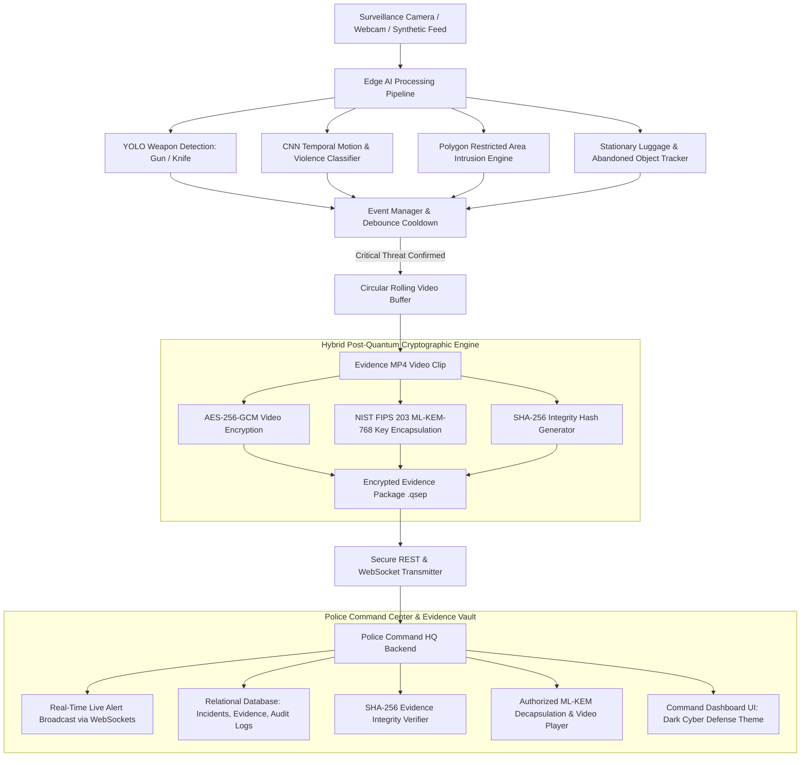

# Edge AI-Based Crime Detection and Quantum-Safe Digital Evidence Management Framework

[](https://www.python.org/)
[](https://fastapi.tiangolo.com/)
[](https://docs.ultralytics.com/)
[](https://csrc.nist.gov/pubs/fips/203/final)
[](https://en.wikipedia.org/wiki/Galois/Counter_Mode)

A real-time intelligent surveillance framework combining **Edge AI multi-threat detection** (weapons, physical violence, restricted area perimeter intrusion, abandoned luggage) with **Hybrid Post-Quantum Cryptography (AES-256-GCM + NIST FIPS 203 ML-KEM-768)** and a **Police Command HQ Dashboard**.

---

## 🌟 Key System Capabilities

1. **Real-Time Edge AI Computer Vision Pipeline**:
   - **YOLO Weapon Detection**: Real-time identification of Guns, Pistols, Rifles, Knives, and customizable weapon classes with configurable confidence thresholds and IoU tracking.
   - **Temporal Violence & Anomaly Classifier**: Spatial-temporal optical flow energy analysis to detect physical struggles, fights, and sudden erratic motion dynamics.
   - **Restricted Area Intrusion Detection**: Ray-casting point-in-polygon algorithm checking bottom-center coordinates of subjects against geo-fenced perimeters.
   - **Stationary Luggage Tracker**: Tracks luggage (`backpack`, `handbag`, `suitcase`), evaluates stationary duration, and calculates owner-detachment distance to alert on abandoned objects.
   - **Circular Video Buffer**: Continuous rolling 5-second FIFO ring buffer ensuring pre-event context is captured alongside active incident frames and 10-second post-event footage.
   - **Debounce Controller**: Prevents alert flooding when a threat remains visible across continuous video frames.

2. **Quantum-Safe Hybrid Digital Evidence Security**:
   - **Authenticated Symmetric Encryption**: Video files are encrypted using **AES-256-GCM** with a freshly generated 256-bit symmetric session key, 96-bit random nonce (IV), and 128-bit authentication tag.
   - **NIST FIPS 203 ML-KEM-768 (CRYSTALS-Kyber)**: Post-quantum lattice-based Key Encapsulation Mechanism (Module-LWE over $\mathbb{Z}_{3329}[X]/(X^{256}+1)$) protecting the AES symmetric key against quantum computers running Shor's algorithm.
   - **Evidence Integrity Verification**: Generates pre-encryption **SHA-256** digests. Demonstrates tamper detection with immediate `✅ Evidence Integrity Verified` or `❌ Evidence Integrity Check Failed` indicators.
   - **Encrypted Evidence Package (.qsep)**: Self-contained, tamper-evident cryptographic container storing encrypted payloads, KEM ciphertext, and cryptographic metadata.

3. **Police Command HQ & Tactical Dashboard**:
   - **Dark Glassmorphic Cyber Command UI**: Responsive Single-Page Application (SPA) with real-time HUD telemetry, multi-camera grid, and live FPS indicators.
   - **Instant Real-Time WebSocket Alerts**: Automated audio sirens and critical pulsing red alerts dispatched instantaneously on weapon/threat detection.
   - **Quantum Evidence Vault**: Authorized officer authentication (JWT + RBAC), SHA-256 integrity verification, and browser video streaming after post-quantum ML-KEM decapsulation.
   - **Restricted Zone Configurator**: Interactive HTML5 canvas for drawing and saving custom perimeter geofence polygons.
   - **Immutable Forensic Audit Trail**: Cryptographic logging of every user login, evidence upload, hash verification, and decapsulation event.

---

## 🏛️ System Architecture Flow



---

## 🚀 Quick Start Guide

### Option A: One-Click Interactive Launcher (Windows)
Double-click [`run.bat`](file:///s:/SS%20TECHNOLOGIES%20PROJECT%20TITES/PYTHON%20PROJECT/MCET/run.bat) or run in terminal:
```powershell
.\run.bat
```
This opens an interactive menu allowing you to launch the Police Server, run demonstrations, start live Edge AI surveillance, or run test suites with a single keypress.

---

### Option B: Manual Command Line

#### 1. Installation

Clone or navigate to the project directory:
```powershell
pip install -r requirements.txt
```

#### 2. Launch the Police Command HQ Server

Start the backend server on `http://localhost:8000`:
```powershell
python run_server.py
```

### 3. Open the Police Dashboard

Open your web browser and navigate to:
```
http://localhost:8000
```
Default Credentials:
- **Administrator**: `admin` / `PoliceSecure2026!`
- **Police Officer**: `officer` / `OfficerPass2026!`

---

## 🎬 Running Demonstrations

### A. Automated End-to-End Demonstration Scenario
Run the complete automated scenario demonstrating normal surveillance, weapon detection, red alert, AES-256-GCM + ML-KEM-768 encryption, transmission, officer login, SHA-256 integrity verification, and authorized video playback:
```powershell
python run_demo.py
```

### B. Live Edge AI Surveillance Worker
Run the real-time AI worker (supports webcam, IP camera, video file, or synthetic CCTV simulation):
```powershell
# Synthetic CCTV Simulation (Zero Hardware Needed)
python run_edge_ai.py --source demo --camera CAM-01

# Physical Webcam
python run_edge_ai.py --source webcam --camera CAM-01

# RTSP / IP Camera
python run_edge_ai.py --source "rtsp://192.168.1.100/stream" --camera CAM-02

# Local Video File
python run_edge_ai.py --source "surveillance_test.mp4" --camera CAM-03
```

---

## 🧪 Automated Testing Suite

Run the full automated test suite with pytest (17 comprehensive tests):
```powershell
pytest tests/ -v
```

Test Coverage:
1. `test_crypto_hybrid.py`: Validates ML-KEM-768 key generation, encapsulation, decapsulation, AES-256-GCM authenticated encryption, SHA-256 integrity, and bit-flip tamper detection.
2. `test_yolo_detection.py`: Validates YOLO object & weapon inference, class mapping, and HUD overlays.
3. `test_features.py`: Validates optical-flow violence detection, point-in-polygon intrusion math, and abandoned luggage tracking.
4. `test_api_and_auth.py`: Validates JWT login, RBAC endpoints, incident recording, evidence upload, hash verification, and authorized decryption.

---

## 📁 Project Directory Structure

```
MCET/
├── backend/
│   ├── app/
│   │   ├── main.py                  # FastAPI server & lifespan seeding
│   │   ├── config.py                # System settings & paths
│   │   ├── database.py              # SQLAlchemy engine & ML-KEM key storage
│   │   ├── models/                  # Users, Cameras, Incidents, Evidence, AuditLog, Zone
│   │   ├── schemas/                 # Pydantic validation schemas
│   │   ├── api/                     # REST API route handlers
│   │   ├── websocket/               # WebSocket connection & alert manager
│   │   └── security/                # JWT bearer auth & bcrypt password hashing
│   └── crypto/                      # Quantum-Safe Cryptography Engine
│       ├── ml_kem.py                # NIST FIPS 203 ML-KEM (Kyber-768) Engine
│       ├── aes_gcm.py               # AES-256-GCM Authenticated Encryption
│       ├── hybrid_envelope.py       # Quantum-Safe Evidence Package (.qsep) Builder
│       └── integrity.py             # SHA-256 Cryptographic Hash Verifier
├── edge_ai/                         # Edge Surveillance & Computer Vision Pipeline
│   ├── camera_stream.py             # Stream reader (Webcam, RTSP, Video, Synthetic Demo)
│   ├── buffer_manager.py            # Pre-event & post-event circular rolling video buffer
│   ├── detector.py                  # YOLO-based object & weapon detection engine
│   ├── violence_detector.py         # Optical flow temporal violence classifier
│   ├── intrusion_detector.py        # Ray-casting restricted zone intrusion detector
│   ├── abandoned_tracker.py         # Stationary luggage & owner detachment tracker
│   ├── event_manager.py             # Debounce controller & incident ID generator
│   ├── evidence_recorder.py         # Video compilation + hybrid encryption pipeline
│   └── edge_transmitter.py          # Secure client for dispatching incidents to HQ
├── frontend/                        # Police Command Center UI (Single Page Application)
│   ├── static/
│   │   ├── css/styles.css           # Premium cyber defense dark glassmorphism
│   │   └── js/                      # Modular client logic (API, WebSocket, Live, Vault, Zones)
│   └── templates/index.html         # Command dashboard UI layout
├── storage/                         # Evidence & Cryptographic Key Storage
│   ├── encrypted_evidence/          # .qsep post-quantum encrypted packages
│   ├── decrypted_cache/             # Ephemeral decrypted stream buffer
│   └── police_keys/                 # ML-KEM Police Public & Secret Keypairs
├── tests/                           # 17 Automated Verification Tests
├── run_server.py                    # Backend server launcher
├── run_edge_ai.py                   # Edge AI surveillance worker
├── run_demo.py                      # Interactive end-to-end demo runner
└── requirements.txt                 # Project dependencies
```

---

## 🔐 Cryptographic Specifications

| Component | Standard / Algorithm | Security Level / Parameter |
| :--- | :--- | :--- |
| **Key Encapsulation (PQC)** | **NIST FIPS 203 ML-KEM-768** | NIST Category 3 (192-bit classical equivalent, quantum-resistant) |
| **Symmetric Encryption** | **AES-256-GCM** | 256-bit key, 96-bit nonce, 128-bit authentication tag |
| **Integrity Digest** | **SHA-256 (FIPS 180-4)** | 256-bit cryptographic bitstream hash |
| **Evidence Package** | **QSEP / 1.0** | Hybrid post-quantum self-authenticating container |
| **Authentication** | **JWT + Bcrypt** | HMAC-SHA256 bearer tokens with 24-hour expiration |

---

## 📜 Academic Project Highlights

- **Zero External Binary Dependencies**: ML-KEM-768 and AES-256-GCM run seamlessly in pure Python/C-accelerated primitives across Windows, Linux, and macOS.
- **Fail-Safe Offline Queueing**: If edge network connection drops, evidence packages are retained locally in `storage/offline_queue/` and retried automatically.
- **Zero Plaintext Leakage**: Plaintext video bitstreams are never transmitted over the network or exposed to unauthorized users.
- **Forensic Chain of Custody**: Every stage (capture, encryption, upload, integrity check, decryption) is recorded in an immutable forensic audit log.
